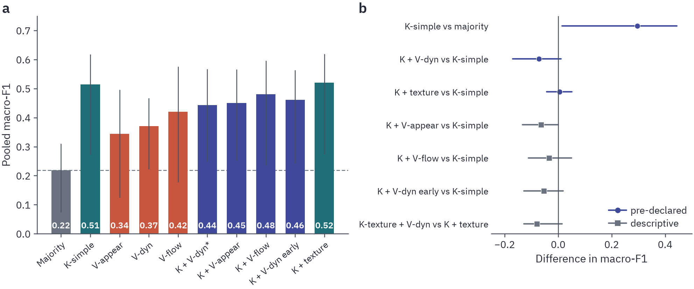
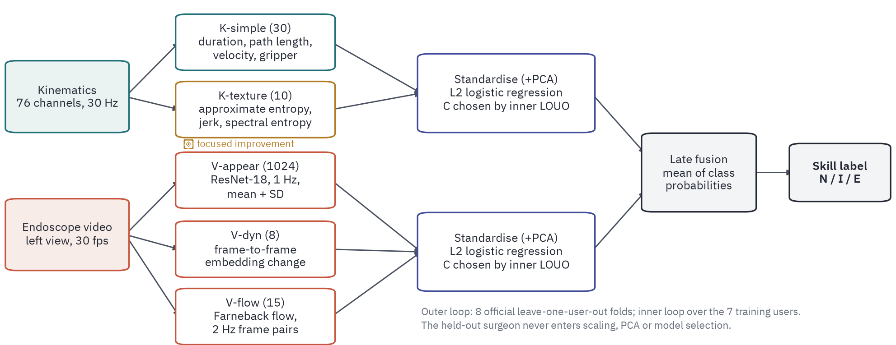
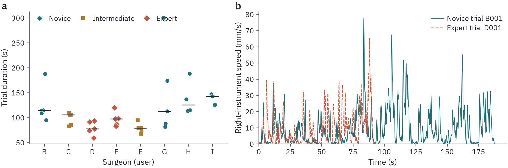
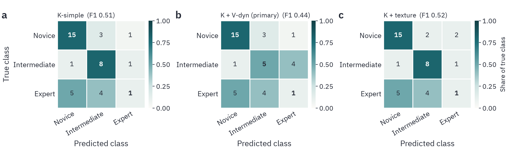
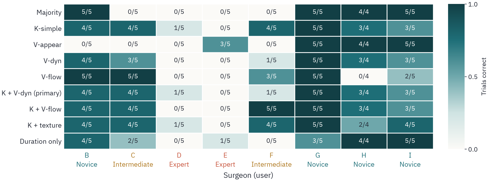
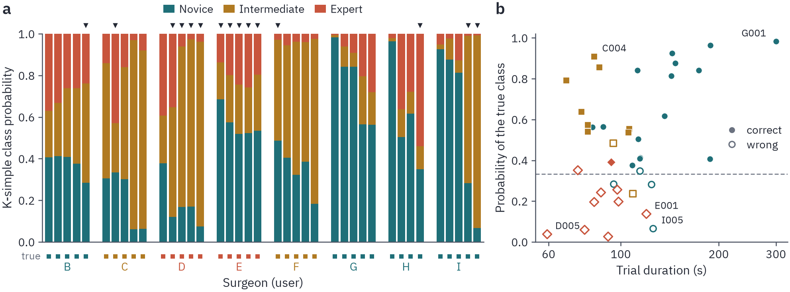
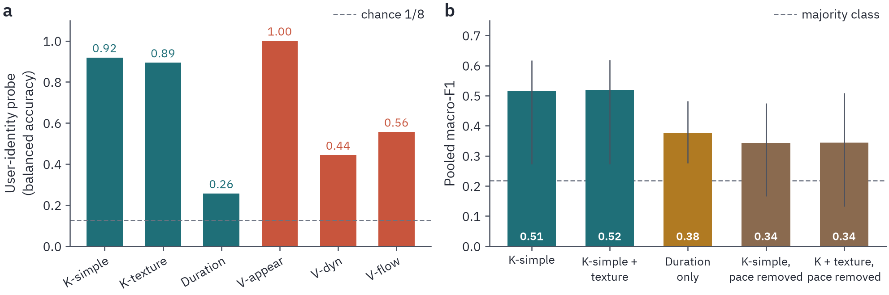
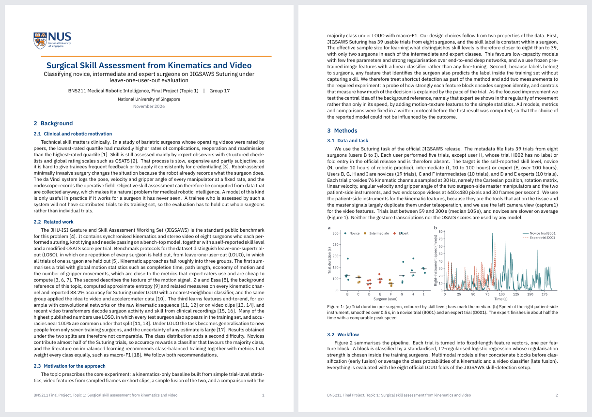
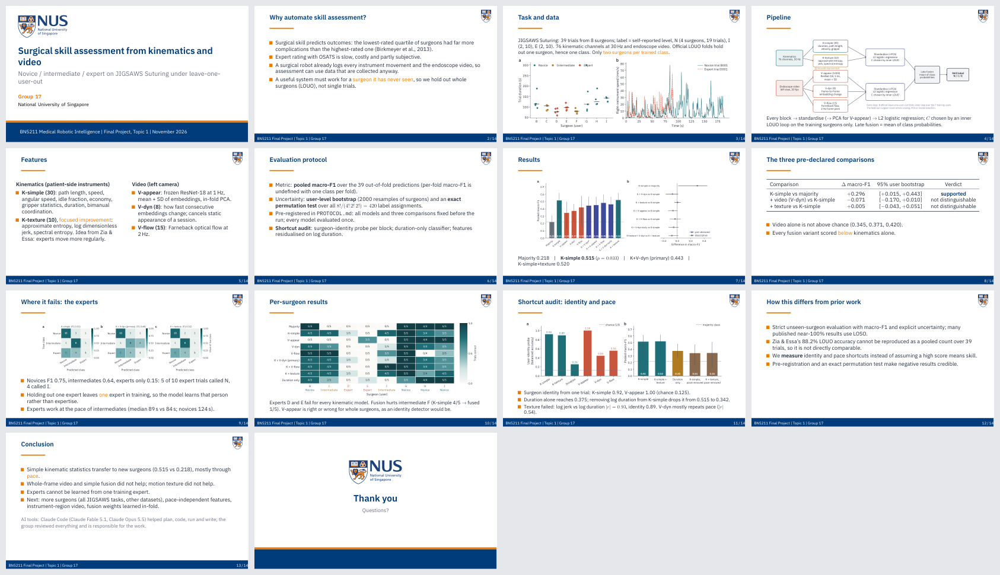

**English** | [中文](README_zh.md)

# JIGSAWS-SkillLOUO: novice / intermediate / expert from kinematics and video, on surgeons the model has never seen



*(a) Pooled macro-F1 of every model on JIGSAWS Suturing under the official leave-one-user-out folds. Grey: majority class; teal: kinematics; red: video only; blue: kinematics + video. Error bars are 95% user-level bootstrap intervals. (b) Paired differences; circles are the three comparisons written down before the run.*

NUS **BN5211 Medical Robotic Intelligence**, Final Project, Topic 1 · Group 17 · JIGSAWS Suturing, 39 trials, 8 surgeons

## One sentence

Under strict leave-one-user-out evaluation, simple trial-level kinematic statistics beat the majority class (macro-F1 **0.515 vs 0.218**, exact permutation p = 0.033), but **adding video did not help** (best fusion 0.481, the pre-declared one 0.443), motion-texture features changed nothing (**0.520**), and a shortcut audit shows why: the signal that transfers to new surgeons is **mostly the pace of the trial**, which separates novices from trained surgeons but cannot tell intermediates from experts. The expert class is almost never recognised (F1 0.15).

## The question

Robotic surgery already logs every instrument movement and the endoscope video, so skill assessment could run on data that are collected anyway. Such a system is only useful if it works for **a surgeon it has never seen**. Many published JIGSAWS numbers near 100% use the LOSO split, where every test surgeon also has trials in the training set. Under LOUO the whole surgeon is held out, the label is constant within a surgeon, and the effective sample size is closer to **8** than to 39, with only **two surgeons each** in the intermediate and expert classes.

The project follows the course's prescribed experiment (majority class, kinematics-only baseline, video features from sampled frames, a simple fusion, LOUO, macro-F1) and adds one focused improvement (motion texture, after Zia & Essa 2018) plus two measurements of shortcuts: how much each feature block identifies the surgeon, and how much of each decision is explained by trial duration.

## Setup

| | |
|---|---|
| Data | JIGSAWS Suturing, 39 trials from 8 surgeons (B to I). Self-reported level: **N** = B, G, H, I (19 trials); **I** = C, F (10); **E** = D, E (10). 76 kinematic channels at 30 Hz, endoscope video 640×480 at 30 fps. |
| Split | The 8 official LOUO folds of the JIGSAWS skill-detection setup, checked in code (each fold holds out exactly one surgeon). Hyperparameters are chosen by an **inner** LOUO over the 7 training surgeons only. |
| Classifier | Standardise (+ PCA for V-appear) → L2 logistic regression, class-balanced, C chosen in the inner loop. Late fusion = mean of class probabilities; early fusion = concatenated blocks. |
| Metric | Pooled macro-F1 over the 39 out-of-fold predictions (per-fold macro-F1 is undefined when a fold has one class), 95% interval from 2000 **user-level** bootstrap resamples, exact user-level permutation test over all 420 label assignments. |
| Pre-registration | [`PROTOCOL.md`](PROTOCOL.md) fixed every model, metric and the three primary comparisons before the first result. Every model was evaluated once. |
| Hardware | One laptop, RTX 3060 Laptop GPU (6 GB), Windows 11. Features ≈ 3 min, all models + statistics < 2 min. |



### Feature blocks

| Block | Dim | What it is |
|---|---|---|
| **K-simple** | 30 | Path length, speed, angular speed, idle fraction, motion economy, gripper statistics, duration, bimanual coordination (patient-side instruments). |
| **K-texture** | 10 | The focused improvement: approximate entropy, log dimensionless jerk, spectral entropy. Idea from Zia & Essa: experts move more regularly, not only faster. |
| **V-appear** | 512 → PCA | Frozen ImageNet ResNet-18 on frames sampled at 1 Hz, mean + SD of embeddings. |
| **V-dyn** | 8 | How fast consecutive embeddings change; designed to cancel the static appearance of a recording session. |
| **V-flow** | 15 | Farneback optical-flow statistics at 2 Hz. |



*The data in one picture: novices are slower, but the two experts (D, E) are no faster than the two intermediates (C, F).*

## Results

| Model | ID | Macro-F1 [95% CI] | Acc. | F1 N | F1 I | F1 E | p |
|---|---|---|---|---|---|---|---|
| Majority class | M0 | 0.218 [0.074, 0.310] | 0.487 | 0.66 | 0.00 | 0.00 | 1.000 |
| **K-simple** | M1 | **0.515** [0.272, 0.618] | 0.615 | 0.75 | 0.64 | 0.15 | 0.033 |
| V-appear | M2a | 0.345 [0.125, 0.496] | 0.436 | 0.72 | 0.00 | 0.32 | 0.455 |
| V-dyn | M2b | 0.371 [0.222, 0.467] | 0.487 | 0.75 | 0.36 | 0.00 | 0.348 |
| V-flow | M2c | 0.420 [0.178, 0.576] | 0.513 | 0.67 | 0.59 | 0.00 | 0.240 |
| **K-simple + V-dyn, late (primary)** | M3 | **0.443** [0.247, 0.568] | 0.538 | 0.75 | 0.45 | 0.12 | 0.188 |
| K-simple + V-appear, late | M3b | 0.450 [0.253, 0.567] | 0.538 | 0.72 | 0.50 | 0.13 | 0.133 |
| K-simple + V-flow, late | M3c | 0.481 [0.236, 0.596] | 0.615 | 0.75 | 0.69 | 0.00 | 0.062 |
| K-simple + V-dyn, early | M3d | 0.461 [0.242, 0.564] | 0.615 | 0.74 | 0.64 | 0.00 | 0.036 |
| **K-simple + K-texture** | M4 | **0.520** [0.273, 0.619] | 0.615 | 0.75 | 0.67 | 0.14 | 0.074 |
| (K-simple + K-texture) + V-dyn, late | M5 | 0.440 [0.259, 0.526] | 0.538 | 0.73 | 0.45 | 0.13 | 0.157 |
| *Control:* duration only | C1 | 0.375 [0.275, 0.482] | 0.487 | 0.82 | 0.20 | 0.11 | 0.367 |
| *Control:* K-simple residualised on log duration | C2 | 0.342 [0.167, 0.475] | 0.385 | 0.47 | 0.43 | 0.12 | 0.445 |
| *Control:* K-simple + K-texture, residualised | C2t | 0.344 [0.132, 0.509] | 0.385 | 0.38 | 0.53 | 0.12 | 0.371 |

### 1. The three pre-declared comparisons

| Comparison | Δ macro-F1 | 95% user bootstrap | Verdict |
|---|---|---|---|
| K-simple − majority | +0.296 | [+0.015, +0.443] | **supported** |
| + video (V-dyn, late) − K-simple | −0.071 | [−0.170, +0.010] | not distinguishable, point estimate negative |
| + motion texture − K-simple | +0.005 | [−0.043, +0.051] | not supported |

No video block alone is distinguishable from chance (p = 0.455, 0.348, 0.240), and **every** fusion variant scored below kinematics alone.

### 2. Where it fails: the experts



Novices are recognised well (F1 0.75), intermediates moderately (0.64), experts almost never (0.15): of the ten expert trials, K-simple calls five novice, four intermediate and one expert.



Per surgeon, expert D gets one trial right in every kinematic model and expert E none. The cause is structural: when one expert is held out, **the training set contains exactly one expert surgeon**, so the model learns that person rather than what experts share.



Single trials show the two experts failing in **opposite directions**, which is what learning one person looks like. With E held out, the only training expert is D (59 to 93 s); E's trials (83 to 120 s) look slow for an expert and all five are called novice (E001: novice probability 0.69, expert 0.14). With D held out, the only training expert is E, so the fastest training trials belong to the intermediates, and four of D's five trials are called intermediate, including D005, the shortest trial in the dataset (59 s, intermediate probability 0.89). Not every error is duration: the last two trials of novice I last about two minutes and are still called intermediate with high confidence.

### 3. The shortcut audit: identity and pace



- **Identity.** An eight-way probe recognises the surgeon from a single trial with balanced accuracy 0.92 from K-simple, 0.89 from K-texture and **1.00 from V-appear** (chance 0.125). V-appear is a perfect session detector and only a 0.345 skill classifier: it is right on every trial of novices G, H, I and wrong on every trial of novice B and both intermediates.
- **Pace.** Duration alone reaches macro-F1 0.375. Removing the linear dependence on log duration from every K-simple feature (inside each training fold) drops K-simple from **0.515 to 0.342**. The transferable signal is largely how long the trial takes.
- **Why texture failed.** Log dimensionless jerk correlates with log duration at |r| = 0.93, and the texture block identifies the surgeon almost as well as K-simple. The ten features mostly duplicate pace and identity.
- **Why fusion hurt.** V-dyn carries less identity (0.44) but is even more tied to pace (median |r| with log duration 0.54 vs 0.42 for K-simple), so it adds a noisier copy of what kinematics already has. Equal-weight late fusion then drags down surgeons that kinematics gets right: intermediate F goes from 4/5 (K-simple) to 1/5 (fused).

### 4. Comparison with the literature

Zia & Essa (2018) report 88.2% LOUO accuracy on Suturing. With 39 pooled predictions, accuracy moves in steps of 2.56 points and 88.2% is not reachable, so that evaluation must have used a different trial set or aggregation; it also reports accuracy rather than macro-F1. Our intervals are 0.25 to 0.4 wide: one surgeon changing class moves macro-F1 by more than 0.1.

## Honest limits

- Eight surgeons. Differences smaller than about 0.1 to 0.2 in macro-F1 cannot be resolved, and the expert class cannot be learned from one training surgeon.
- The label is self-reported hours of practice, not rated performance.
- The video features describe whole frames and never look at the needle, thread or tissue, which is where quality would show.
- Equal-weight late fusion is a crude rule that lets the weaker modality pull down the stronger one.
- The K-texture block is far smaller than Zia & Essa's per-channel bank. The larger bank was not tested, because it was not in the protocol and choosing it after seeing these results would bias the comparison.

## Reproduce

### 1. Get the data (not redistributed here)

JIGSAWS is distributed by Johns Hopkins University after registration: [JIGSAWS release page](https://cirl.lcsr.jhu.edu/research/hmm/datasets/jigsaws_release/). Place it under `data/`, or point two environment variables at it:

```
JIGSAWS_SUTURING   the Suturing folder (kinematics/AllGestures/, video/, meta_file_Suturing.txt)   default data/Suturing
JIGSAWS_SPLITS     the Experimental_setup folder of the official splits                            default data/Experimental_setup
```

The code reads the folds from `Experimental_setup/Suturing/unBalanced/SkillDetection/UserOut` and asserts that each fold holds out exactly one surgeon.

### 2. Run

```bash
pip install -r requirements.txt     # plus torch / torchvision for your CUDA version
python code/run_all.py              # all features + every model once -> results/   (~5 min on an RTX 3060 laptop)
python code/make_tables.py          # LaTeX macros and tables from results/results.json
python code/make_figures.py         # figures 2-7 (EN and ZH)
python code/fig_pipeline.py         # figure 1
```

`make_tables.py`, `make_figures.py` and `fig_pipeline.py` work from the saved `results/` without the raw data, except Figure 2, which reads raw kinematics. All randomised steps use seed 0. `logs/run_all.log` is the log of the single evaluation run behind every number above.

### 3. Rebuild the report and slides (optional)

XeLaTeX + BibTeX (TeX Live 2025). Fonts: IBM Plex Sans (in `fonts/`, SIL OFL), IBM Plex Mono and IBM Plex Math installed system-wide, and Microsoft YaHei for the Chinese report.

```bash
cd report     && xelatex -output-directory=build main && bibtex build/main && xelatex -output-directory=build main && xelatex -output-directory=build main
cd report_zh  && (same commands)
cd slides     && xelatex -output-directory=build slides_en && xelatex -output-directory=build slides_en
```

## Report and slides

The compiled PDFs are in [`docs/`](docs/): [report (English, 11 pages)](docs/report_en.pdf), [report (Chinese, 10 pages)](docs/report_zh.pdf), [slides (14 pages)](docs/slides_en.pdf). Member names and student IDs are left out of this public version.





## Layout

```
code/
  data.py               metadata, kinematics and video loading; official LOUO folds with checks
  features_kin.py       K-simple (30) and K-texture (10)
  features_video.py     ResNet-18 embeddings (V-appear, V-dyn) and Farneback flow (V-flow), cached per trial
  evaluate.py           nested LOUO, late/early fusion, metrics, user-level bootstrap, exact permutation test, identity probe
  run_all.py            builds all features, evaluates every model once, writes results/
  make_tables.py        LaTeX macros + tables from results/results.json
  make_figures.py       figures 2-7;  fig_pipeline.py  figure 1;  bn5211_style.py / plot_helpers.py  shared style
results/
  results.json          every metric, paired difference, audit result and the software environment
  predictions_*.csv     out-of-fold predictions per model
  features_*.csv        trial-level feature tables
figures/                fig1-fig7, PNG + PDF, English and Chinese (_zh)
report/  report_zh/     LaTeX sources of the English and Chinese reports
slides/                 LaTeX source of the slides (beamer, NUS theme) and logo assets
docs/                   compiled report and slide PDFs
media/                  previews used in this README
logs/run_all.log        log of the single evaluation run
PROTOCOL.md             the pre-registered protocol, frozen before the first result
```

## Sources and acknowledgements

- Gao et al., *JHU-ISI Gesture and Skill Assessment Working Set (JIGSAWS)*, MICCAI Workshop M2CAI, 2014; Ahmidi et al., *A dataset and benchmarks for segmentation and recognition of gestures in robotic surgery*, IEEE TBME, 2017 (official splits).
- Zia & Essa, *Automated surgical skill assessment in RMIS training*, IJCARS, 2018 (background reference for the motion-texture idea).
- Full bibliography: [`report/references.bib`](report/references.bib).
- NUS logo and crest from Wikipedia, used only to brand this course report.

**AI tools.** Claude Code (Claude Fable 5.1, Claude Opus 5.5) helped plan the experiments, write and debug the code, run them, and draft the report and slides. The group reviewed the code, results and text.

Code under the MIT license. JIGSAWS data are not included and remain under their own terms.
