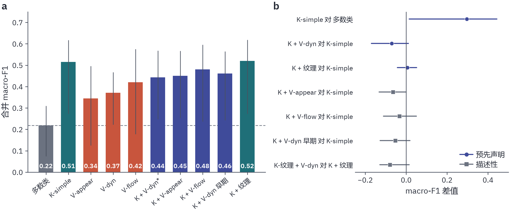
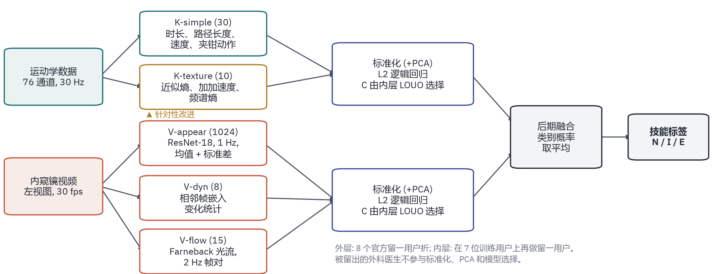
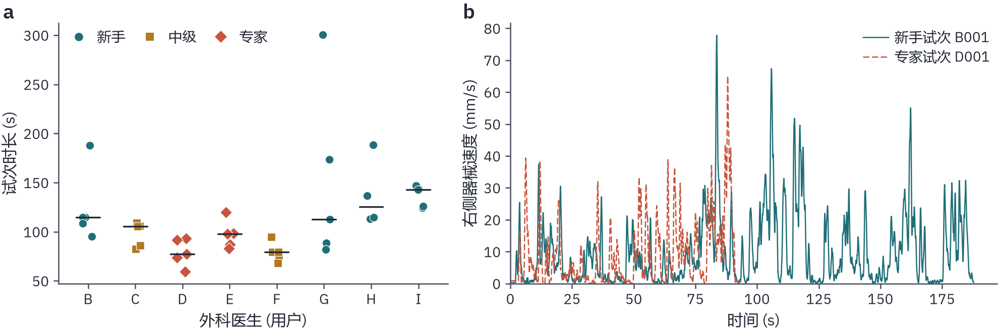
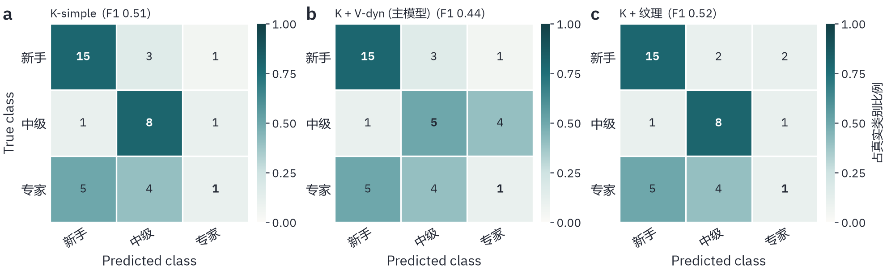
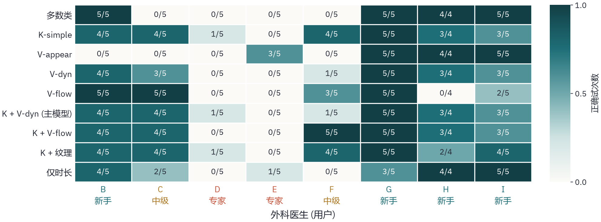
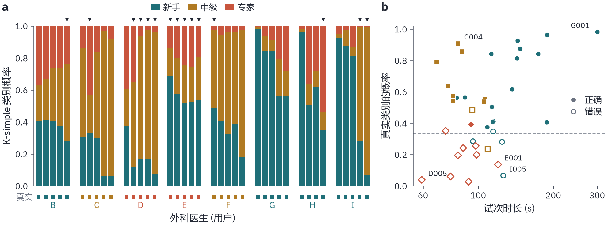
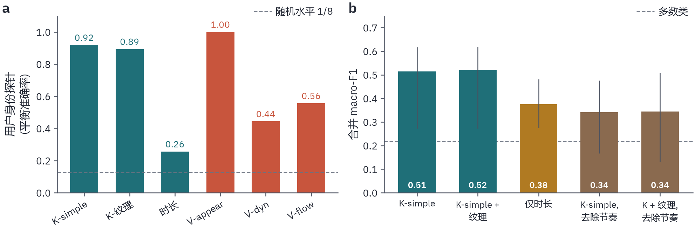
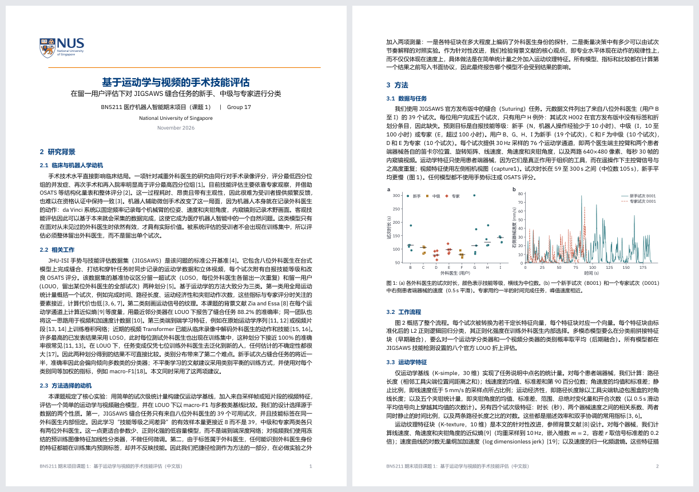

[English](README.md) | **中文**

# RobotSurgery-SkillClassifier：用运动学和视频给“没见过的外科医生”分新手 / 中级 / 专家



*(a) JIGSAWS 缝合任务、官方留一用户（LOUO）划分下各模型的合并 macro-F1。灰色：多数类；青色：运动学；红色：仅视频；蓝色：运动学 + 视频。误差棒为 95% 用户级 bootstrap 区间。(b) 配对差值；圆点是实验前写下的三项比较。*

NUS **BN5211 医疗机器人智能** 期末项目 课题 1 · Group 17 · JIGSAWS 缝合任务，39 个试次，8 位外科医生

## 一句话

在严格的留一用户评估下，简单的试次级运动学统计量明显好于多数类（macro-F1 **0.515 对 0.218**，精确置换检验 p = 0.033）；但**加视频没有帮助**（最好的融合 0.481，预先声明的主融合模型 0.443），运动纹理特征也几乎没变化（**0.520**）。捷径审计解释了原因：能迁移到新医生身上的信号**主要是做得快慢**，它能把新手和受过训练的医生分开，却分不开中级和专家。专家类几乎从未被认出（F1 0.15）。

## 问题

手术机器人本来就记录每个器械的运动和内窥镜视频，技能评估可以直接用这些现成数据。但这种系统只有对**从没见过的医生**也有效才有用。许多 JIGSAWS 上接近 100% 的结果用的是 LOSO 划分，测试医生在训练集里也有试次。LOUO 整个留出一位医生，标签在同一医生内不变，有效样本量更接近 **8** 而不是 39，中级和专家**各只有两位**医生。

本项目按课程规定的实验做（多数类、仅运动学基线、采样帧视频特征、简单融合、LOUO、macro-F1），加一项针对性改进（运动纹理，思路来自 Zia & Essa 2018），再加两项捷径测量：每个特征块能多大程度认出是哪位医生，以及决策有多少能用试次时长解释。

## 设置

| | |
|---|---|
| 数据 | JIGSAWS 缝合任务，8 位医生（B 到 I）共 39 个试次。自报等级：**N** = B、G、H、I（19 个试次）；**I** = C、F（10）；**E** = D、E（10）。76 个运动学通道 30 Hz，内窥镜视频 640×480、30 fps。 |
| 划分 | JIGSAWS 技能检测设置的 8 个官方 LOUO 折，代码里逐一校验（每折恰好留出一位医生）。超参数只在 7 位训练医生上用**内层** LOUO 选。 |
| 分类器 | 标准化（V-appear 再加 PCA）→ L2 逻辑回归，类别平衡，C 由内层选。晚融合 = 类别概率取平均；早融合 = 特征块拼接。 |
| 指标 | 39 个折外预测合并计算 macro-F1（每折只有一个类别时逐折 macro-F1 没有定义），95% 区间来自 2000 次**用户级** bootstrap，精确用户级置换检验遍历全部 420 种标签分配。 |
| 预注册 | [`PROTOCOL.md`](PROTOCOL.md) 在第一个结果出来之前就固定了所有模型、指标和三项主要比较。每个模型只评估一次。 |
| 硬件 | 一台笔记本，RTX 3060 Laptop（6 GB），Windows 11。特征约 3 分钟，全部模型加统计不到 2 分钟。 |



### 特征块

| 特征块 | 维数 | 内容 |
|---|---|---|
| **K-simple** | 30 | 路径长度、速度、角速度、静止比例、运动经济性、夹钳统计、时长、双手协调（患者侧器械）。 |
| **K-texture** | 10 | 针对性改进：近似熵、对数无量纲 jerk、谱熵。思路来自 Zia & Essa：专家的动作更有规律，而不只是更快。 |
| **V-appear** | 512 → PCA | 冻结的 ImageNet ResNet-18，1 Hz 采样帧，嵌入取均值和标准差。 |
| **V-dyn** | 8 | 相邻帧嵌入变化有多快；用来抵消某次录制的静态外观。 |
| **V-flow** | 15 | 2 Hz 的 Farneback 光流统计量。 |



*一张图看数据：新手更慢，但两位专家（D、E）并不比两位中级（C、F）快。*

## 结果

| 模型 | 编号 | Macro-F1 [95% CI] | 准确率 | F1 N | F1 I | F1 E | p |
|---|---|---|---|---|---|---|---|
| 多数类 | M0 | 0.218 [0.074, 0.310] | 0.487 | 0.66 | 0.00 | 0.00 | 1.000 |
| **K-simple** | M1 | **0.515** [0.272, 0.618] | 0.615 | 0.75 | 0.64 | 0.15 | 0.033 |
| V-appear | M2a | 0.345 [0.125, 0.496] | 0.436 | 0.72 | 0.00 | 0.32 | 0.455 |
| V-dyn | M2b | 0.371 [0.222, 0.467] | 0.487 | 0.75 | 0.36 | 0.00 | 0.348 |
| V-flow | M2c | 0.420 [0.178, 0.576] | 0.513 | 0.67 | 0.59 | 0.00 | 0.240 |
| **K-simple + V-dyn，晚融合（主模型）** | M3 | **0.443** [0.247, 0.568] | 0.538 | 0.75 | 0.45 | 0.12 | 0.188 |
| K-simple + V-appear，晚融合 | M3b | 0.450 [0.253, 0.567] | 0.538 | 0.72 | 0.50 | 0.13 | 0.133 |
| K-simple + V-flow，晚融合 | M3c | 0.481 [0.236, 0.596] | 0.615 | 0.75 | 0.69 | 0.00 | 0.062 |
| K-simple + V-dyn，早融合 | M3d | 0.461 [0.242, 0.564] | 0.615 | 0.74 | 0.64 | 0.00 | 0.036 |
| **K-simple + K-texture** | M4 | **0.520** [0.273, 0.619] | 0.615 | 0.75 | 0.67 | 0.14 | 0.074 |
| (K-simple + K-texture) + V-dyn，晚融合 | M5 | 0.440 [0.259, 0.526] | 0.538 | 0.73 | 0.45 | 0.13 | 0.157 |
| *对照：*只用时长 | C1 | 0.375 [0.275, 0.482] | 0.487 | 0.82 | 0.20 | 0.11 | 0.367 |
| *对照：*K-simple 对对数时长取残差 | C2 | 0.342 [0.167, 0.475] | 0.385 | 0.47 | 0.43 | 0.12 | 0.445 |
| *对照：*K-simple + K-texture 取残差 | C2t | 0.344 [0.132, 0.509] | 0.385 | 0.38 | 0.53 | 0.12 | 0.371 |

### 1. 三项预先声明的比较

| 比较 | Δ macro-F1 | 95% 用户级 bootstrap | 结论 |
|---|---|---|---|
| K-simple − 多数类 | +0.296 | [+0.015, +0.443] | **成立** |
| 加视频（V-dyn，晚融合）− K-simple | −0.071 | [−0.170, +0.010] | 无法区分，点估计为负 |
| 加运动纹理 − K-simple | +0.005 | [−0.043, +0.051] | 不成立 |

单独的视频特征块都和随机水平分不开（p = 0.455、0.348、0.240），而且**每一种**融合都比只用运动学差。

### 2. 败在哪里：专家



新手识别得好（F1 0.75），中级一般（0.64），专家几乎认不出（0.15）：十个专家试次里，K-simple 判了五个新手、四个中级、一个专家。



按医生看，专家 D 在每个运动学模型里只对一个试次，专家 E 一个都没对。原因是结构性的：留出一位专家时，**训练集里只剩一位专家**，模型学到的是这个人，而不是专家的共同点。



看单个试次，两位专家**朝相反方向**出错，这正是“学了一个人”的样子。留出 E 时，唯一的训练专家是 D（59 到 93 s）；E 的试次（83 到 120 s）对专家来说显得慢，五个全被判成新手（E001：新手概率 0.69，专家只有 0.14）。留出 D 时，唯一的训练专家是 E，训练集里最快的试次属于中级，于是 D 的五个试次有四个被判成中级，包括全数据集最短的试次 D005（59 s，中级概率 0.89）。并非所有错误都来自时长：新手 I 的最后两个试次都在两分钟左右，仍被高置信度判成中级。

### 3. 捷径审计：身份与节奏



- **身份。** 八分类探针从单个试次认出是哪位医生，平衡准确率：K-simple 0.92，K-texture 0.89，**V-appear 1.00**（随机 0.125）。V-appear 是完美的“录制场次识别器”，作为技能分类器却只有 0.345：新手 G、H、I 的试次全对，新手 B 和两位中级全错。
- **节奏。** 只用时长就有 macro-F1 0.375。在每个训练折内把 K-simple 每个特征对对数时长的线性依赖去掉，K-simple 从 **0.515 掉到 0.342**。能迁移的信号大部分就是试次花了多长时间。
- **纹理为什么没用。** 对数无量纲 jerk 和对数时长的相关 |r| = 0.93，纹理块认人的能力也和 K-simple 差不多。这十个特征基本重复了节奏和身份信息。
- **融合为什么反而变差。** V-dyn 的身份信息少一些（0.44），但和节奏绑得更紧（与对数时长的中位 |r| 为 0.54，K-simple 是 0.42），相当于加了一份更嘈杂的运动学已有信息。等权晚融合又会拖累运动学本来判对的医生：中级 F 从 4/5（K-simple）掉到 1/5（融合后）。

### 4. 与文献比较

Zia & Essa（2018）报告缝合任务 LOUO 准确率 88.2%。39 个合并预测的准确率只能以 2.56 个百分点为步长变化，88.2% 根本取不到，所以那次评估一定用了不同的试次集合或汇总方式；而且报告的是准确率，不是 macro-F1。我们的区间宽 0.25 到 0.4：一位医生换个类别，macro-F1 就能变 0.1 以上。

## 诚实的局限

- 只有八位医生。小于约 0.1 到 0.2 的 macro-F1 差异分辨不出来；只有一位训练专家，专家类学不出来。
- 标签是自报的练习时长，不是评分出来的表现。
- 视频特征描述的是整帧画面，从不看针、线和组织，而操作质量恰恰体现在这些地方。
- 等权晚融合太粗糙，弱模态会把强模态拉下来。
- K-texture 比 Zia & Essa 逐通道的特征库小得多。更大的特征库没有测，因为它不在协议里，看完结果再选会让比较有偏。

## 复现

### 1. 获取数据（本仓库不分发）

JIGSAWS 由约翰斯·霍普金斯大学注册后发放：[JIGSAWS 发布页](https://cirl.lcsr.jhu.edu/research/hmm/datasets/jigsaws_release/)。放到 `data/` 下，或用两个环境变量指过去：

```
JIGSAWS_SUTURING   Suturing 文件夹（kinematics/AllGestures/、video/、meta_file_Suturing.txt）   默认 data/Suturing
JIGSAWS_SPLITS     官方划分的 Experimental_setup 文件夹                                          默认 data/Experimental_setup
```

代码从 `Experimental_setup/Suturing/unBalanced/SkillDetection/UserOut` 读折，并断言每折恰好留出一位医生。

### 2. 运行

```bash
pip install -r requirements.txt     # 另按 CUDA 版本装 torch / torchvision
python code/run_all.py              # 全部特征 + 每个模型各跑一次 -> results/   （RTX 3060 笔记本约 5 分钟）
python code/make_tables.py          # 从 results/results.json 生成 LaTeX 宏和表格
python code/make_figures.py         # 图 2-7（中英文）
python code/fig_pipeline.py         # 图 1
```

`make_tables.py`、`make_figures.py`、`fig_pipeline.py` 只读保存好的 `results/`，不需要原始数据；只有图 2 要读原始运动学。所有随机步骤种子为 0。`logs/run_all.log` 是上面所有数字背后那唯一一次评估运行的日志。

### 3. 重新编译报告和幻灯片（可选）

XeLaTeX + BibTeX（TeX Live 2025）。字体：IBM Plex Sans（在 `fonts/`，SIL OFL 许可）、系统安装的 IBM Plex Mono 和 IBM Plex Math，中文报告还需要微软雅黑。

```bash
cd report     && xelatex -output-directory=build main && bibtex build/main && xelatex -output-directory=build main && xelatex -output-directory=build main
cd report_zh  && （同上）
cd slides     && xelatex -output-directory=build slides_en && xelatex -output-directory=build slides_en
```

## 报告和幻灯片

编译好的 PDF 在 [`docs/`](docs/)：[英文报告（11 页）](docs/report_en.pdf)、[中文报告（10 页）](docs/report_zh.pdf)、[幻灯片（14 页）](docs/slides_en.pdf)。公开版去掉了组员姓名和学号。




## 目录

```
code/
  data.py               元数据、运动学和视频读取；官方 LOUO 折及校验
  features_kin.py       K-simple（30）和 K-texture（10）
  features_video.py     ResNet-18 嵌入（V-appear、V-dyn）和 Farneback 光流（V-flow），按试次缓存
  evaluate.py           嵌套 LOUO、晚/早融合、指标、用户级 bootstrap、精确置换检验、身份探针
  run_all.py            构建全部特征，每个模型评估一次，写入 results/
  make_tables.py        从 results/results.json 生成 LaTeX 宏和表格
  make_figures.py       图 2-7；fig_pipeline.py 图 1；bn5211_style.py / plot_helpers.py 公共样式
results/
  results.json          所有指标、配对差值、审计结果和软件环境
  predictions_*.csv     各模型的折外预测
  features_*.csv        试次级特征表
figures/                图 1-7，PNG + PDF，中英文（_zh）
report/  report_zh/     英文、中文报告的 LaTeX 源码
slides/                 幻灯片 LaTeX 源码（beamer，NUS 配色）和校徽素材
docs/                   编译好的报告和幻灯片 PDF
media/                  本 README 用的预览图
logs/run_all.log        唯一一次评估运行的日志
PROTOCOL.md             预注册协议，在第一个结果之前冻结
```

## 来源与致谢

- Gao et al., *JHU-ISI Gesture and Skill Assessment Working Set (JIGSAWS)*, MICCAI Workshop M2CAI, 2014；Ahmidi et al., *A dataset and benchmarks for segmentation and recognition of gestures in robotic surgery*, IEEE TBME, 2017（官方划分）。
- Zia & Essa, *Automated surgical skill assessment in RMIS training*, IJCARS, 2018（运动纹理思路的背景文献）。
- 完整参考文献：[`report/references.bib`](report/references.bib)。
- NUS 校徽和标志来自维基百科，仅用于本课程报告。

**AI 工具。** Claude Code（Claude Fable 5.1、Claude Opus 5.5）参与了实验规划、代码编写与调试、运行实验，以及报告和幻灯片的起草。小组审阅了代码、结果和文字。

代码采用 MIT 许可。不包含 JIGSAWS 数据，数据遵循其自身条款。
